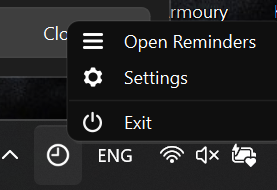
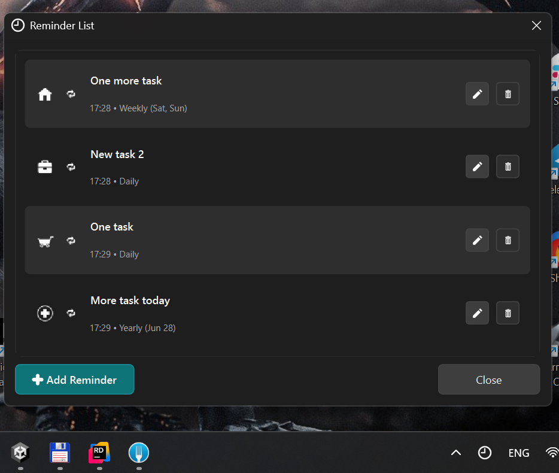
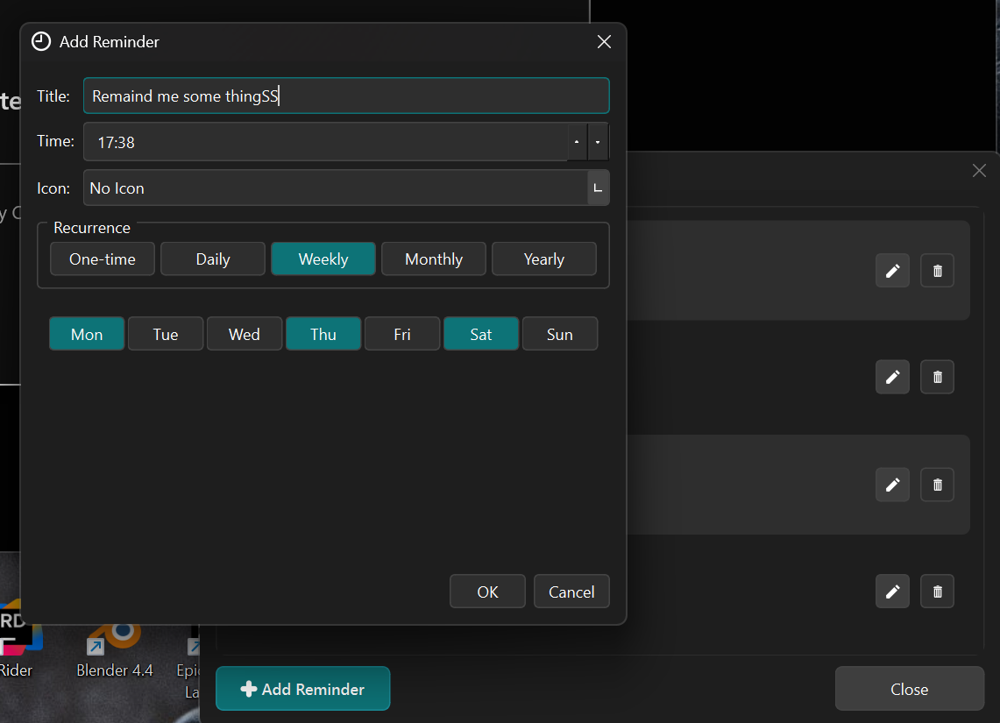
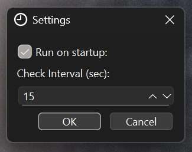

🚀 Notifications for Desktop — 100% AI Coding
----
✨ AI Contributions: Grok 80% · Claude 15% · GPT 5%

✅ Platform: Windows

⚙️ Installation & Usage
---
Requirements:
| # | Requirments |
|---|-------------|
|1|Python (tested with Python 3.10 or higher) + PATH (please do it manually at first)|
|2|pip|
|3|PyQt6|

🔧 Quick Start
---
#1 First instal Python in system add it to PATH.

#2 Dowload repository. Clone it or download packed archive.

#3 Then Install dependencies
Run the installer script:
````
install.bat
````
This will automatically install all required Python packages via pip.

Run the app
---
#4 Start the app using:
````
start.bat
````

📁 Your data
---
Everything personal lives in the `user_data/` folder: your reminders, settings and (later) Google credentials.
Git keeps the folder but ignores everything inside it, so your data never ends up in the repository.
On the first run the folder is filled with the demo data from `sample_data/`.

🐍 Debug mode (optional)
---
If you’d like to run the app directly for debugging:

Rename app.pyw → app.py

Run it from the console:
````
python app.py
````
---

## 📸 Screenshots & Demo

See the app in action! All images and GIFs are in the [Images folder](https://github.com/dust999/Notifications/tree/main/Images).

- 🎞️ [Demo GIF] — quick preview of notifications in action


### Screenshots

| Screenshot | Preview |
|------------|---------|
| Screen 1 |  |
| Screen 2 |  |
| Screen 3 |  |
| Screen 4 |  |

---

📝 Check out the repo for more details: [dust999/Notifications](https://github.com/dust999/Notifications)
